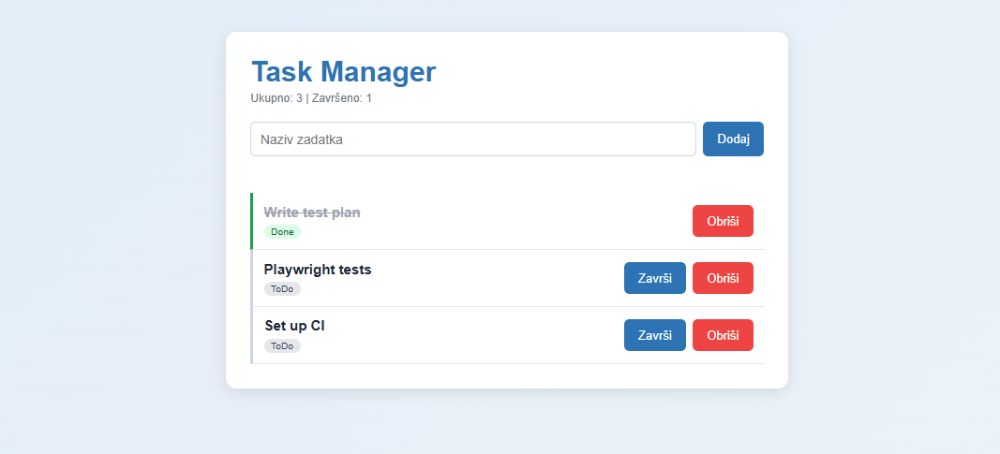

# Task Manager API

[](https://github.com/sarabajric/TaskManager/actions/workflows/ci.yml)

A task management REST API built with ASP.NET Core (.NET 10), with a small web UI and a complete automated test suite. The project was built to practise software quality assurance: unit, API and browser tests, a documented test plan and a CI pipeline.



## Features

- CRUD operations for tasks (create, read, update, delete) via `/api/tasks`
- Input validation and proper HTTP status codes (200, 201, 204, 400, 404)
- Simple web UI served by the API itself (add, complete and delete tasks). The UI labels are in Bosnian.
- Data stored in SQLite with Entity Framework Core migrations

## Tech stack

| Area | Technology |
|---|---|
| Backend | C#, ASP.NET Core Web API, .NET 10 |
| Database | SQLite, Entity Framework Core |
| Unit and API tests | xUnit, WebApplicationFactory |
| UI tests | Playwright for .NET (Chromium, headless) |
| CI | GitHub Actions |
| Packaging | Docker (multi-stage build) |

## Testing

29 automated tests run on every push:

| Level | Count | What it covers |
|---|---|---|
| Unit | 8 | Controller logic in isolation (in-memory SQLite) |
| API | 16 | Real HTTP requests against the running app (temporary database), including negative cases (invalid input, missing resources) |
| UI | 5 | Add, complete and delete a task, validation message, empty list |

**Why separate unit and API tests?** Unit tests are fast and pinpoint a bug in the controller logic. API tests go through the full HTTP stack (routing, serialization, status codes), so they catch problems that unit tests cannot see.

All tests use temporary databases, so the real database is never touched. The full test strategy, test cases and known limitations are in [docs/TEST_PLAN.md](docs/TEST_PLAN.md).

## Bugs found by the tests

Writing negative API tests uncovered a real defect in input validation, which was then fixed.

- **Bug:** the API accepted titles over 200 characters, descriptions over 2000 characters and status numbers that are not defined. SQLite does not enforce the length limits configured in EF Core, so nothing rejected these values.
- **Expected:** such requests are rejected with `400 Bad Request`.
- **Fix:** validation was added to the controller and is covered by test cases API-10 to API-16 and by regression tests.

## CI pipeline

The workflow in [.github/workflows/ci.yml](.github/workflows/ci.yml) has two jobs:

1. **build-and-test**: restores packages, builds, installs Chromium and runs all 29 tests.
2. **docker-build**: builds the Docker image, but only if all tests passed.

## Getting started

Requirements: .NET 10 SDK.

```bash
git clone https://github.com/sarabajric/TaskManager.git
cd TaskManager/TaskManager.Api
dotnet ef database update
dotnet run --launch-profile http
```

Open http://localhost:5196 for the UI. The API endpoints are under `/api/tasks`.

### Run the tests

The browser install is needed only once. Choose the command for your system.

**Windows (PowerShell)**

```powershell
dotnet build
powershell -ExecutionPolicy Bypass -File TaskManager.Tests\bin\Debug\net10.0\playwright.ps1 install chromium
dotnet test
```

**Linux / macOS** (requires [PowerShell](https://learn.microsoft.com/powershell/scripting/install/installing-powershell))

```bash
dotnet build
pwsh TaskManager.Tests/bin/Debug/net10.0/playwright.ps1 install chromium
dotnet test
```

### Run with Docker

```bash
docker build -t taskmanager-api .
docker run -p 8080:8080 taskmanager-api
```

Open http://localhost:8080. The database is created automatically on startup inside the container.

## API overview

| Method | Endpoint | Description |
|---|---|---|
| GET | /api/tasks | List all tasks |
| GET | /api/tasks/{id} | Get one task |
| POST | /api/tasks | Create a task (title is required) |
| PUT | /api/tasks/{id} | Update a task |
| DELETE | /api/tasks/{id} | Delete a task |

## Project structure

```
TaskManager.Api/     API, EF Core model and migrations, static UI (wwwroot)
TaskManager.Tests/   Unit, API and UI tests
docs/                Test plan
.github/workflows/   CI pipeline
Dockerfile           Container image
```

## Author

Sara Bajrić